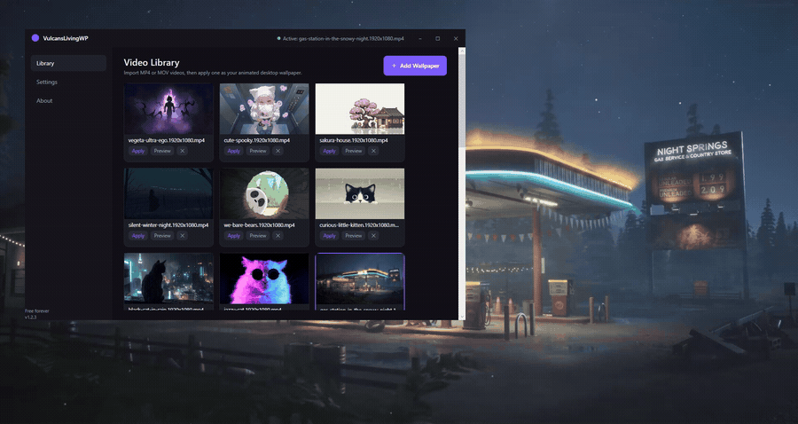

# VulcansLivingWP — Free Animated Live Wallpaper for Windows

VulcansLivingWP turns your own video files into animated desktop wallpapers. The video plays
behind your desktop icons — not in a window on top of them — loops continuously, and pauses
automatically whenever a fullscreen app or game takes over the screen.

It is free, needs no account, and contains no advertising or telemetry. The only network request
is an optional GitHub update check that you can switch off.



*Captured from a two-monitor Windows desktop: the video is playing in the desktop layer, and the
library window floats above it.*

- **Version:** 1.3.4
- **Supported systems:** Windows 10 (64-bit) and Windows 11
- **One installer, no extra downloads:** runtime components ship with Windows
- **New in 1.3.4:** reliability and housekeeping — the fullscreen watcher now polls at 10s when its
  hook is active (2s only when the hook failed), and the 5s health check skips rebuilding the
  wallpaper plan when the monitor topology has not changed. All 1.3.x fixes are included.
- **License:** MIT — see [section 23](#23-license).

---

## 1. What it does

- Plays your own **MP4** and **MOV** videos as an animated desktop wallpaper.
- Injects the video into the Windows desktop layer, so the wallpaper behaves like a normal
  wallpaper: desktop icons stay on top, `Win`+`D` and Task View work as usual.
- Loops the video continuously.
- Pauses automatically when a fullscreen application or game appears, and resumes when it closes.
- Shows the wallpaper on the primary monitor, on all monitors, or on one monitor you choose.
- Gives every monitor its own wallpaper, or stretches one video across several screens as a single
  continuous picture — see [section 6](#6-monitors).
- Fills, fits, or stretches the video to your screen.
- Lets you preview any video **inside the library card** — no separate player window opens.
- Can rotate through your library automatically, changing the wallpaper every 1–60 minutes.
- Sits in the system tray with pause, resume, restore and exit controls.
- Can start automatically when you sign in to Windows.
- Toggles pause/resume with `Ctrl+Alt+W` (configurable, or switchable off).

Your video files are never moved, copied, converted or modified. VulcansLivingWP only stores the
location of each file.

---

## 2. Download and install

1. Download **`VulcansLivingWP_Setup.exe`** from the
   [latest release](https://github.com/pierrelindblom86-rgb/VulcansLivingWP/releases/latest).
2. Double-click it and follow the wizard.
3. Choose whether you want a **desktop shortcut** and whether the app should **start with Windows**
   (both are optional; starting with Windows is recommended so the wallpaper is ready after sign-in).
4. Finish the wizard, and optionally launch the app right away.

The installer puts the application in **`C:\Program Files (x86)\VulcansLivingWP`**. You can pick a
different folder in the wizard if you prefer. Administrator rights are required for the default
location; Windows will ask for permission once.

Upgrading from 1.0.x/1.1.x replaces the old installation in place. Setup stops the running app and
removes the old executables (`FluxWall.exe` and the earlier `VulcansLivingWP.exe`), so an old
pinned shortcut cannot reopen a version that lacks automatic switching. If you pinned the old
app, unpin it and use the current Start-menu shortcut after upgrading.

The installer does not need any development tools, and it does not download anything from the
internet.

---

## 3. First run

The main window opens on the **Library** tab.

1. Click **Add Wallpaper** and pick one or more videos — or simply drag video files onto the library.
2. Each imported video appears as a card with a thumbnail.
3. Click **Set as wallpaper** on a card. The video starts playing on your desktop, behind the icons.
4. Close the window (the **X**) to let it run in the background; the app keeps working from the
   system tray.

With several monitors, **Set as wallpaper** follows the layout you chose on the **Displays** page:
Same all and Span change the one video on screen, while Independent assigns it to the primary
monitor so the other screens keep their own wallpapers. See [section 6](#6-monitors).

A short tray notification appears the first time, pointing out that the app lives in the tray.

---

## 4. Previewing a video

Every card has a **Preview** button.

- Press **Preview**: the video plays **inside that card**, exactly where the thumbnail was.
- Press **Preview** again (or **Stop**): playback stops and the thumbnail returns.
- Starting a preview on another card stops the previous one automatically.

Previewing never opens a second window and never changes your current desktop wallpaper.

---

## 5. Supported formats

| Format | Support |
| --- | --- |
| MP4 (H.264 / AVC) | Recommended — works on essentially every Windows 10/11 PC |
| MP4 (HEVC / H.265) | Only if the HEVC Video Extension is installed |
| MOV (H.264) | Usually works, because Windows can often decode it |
| MOV (ProRes, DNxHD, and other professional codecs) | Not supported by Windows |
| Other containers (MKV, AVI, WebM, WMV) | Not offered by the file picker; may not decode |

Windows decides which videos can be decoded. VulcansLivingWP uses the media components that are
already part of Windows, so it can play exactly what Windows can play. If a file cannot be decoded,
the app reports it instead of showing a black screen.

> **Tip:** for the smoothest result use an H.264-encoded MP4 at 1080p or lower. 4K video plays,
> but every extra pixel costs CPU and battery.

---

## 6. Monitors

VulcansLivingWP has a **Displays** page (third item in the sidebar) with three layout modes.
Switching between them never forgets a wallpaper assignment.

### 6.1 Different wallpaper on every monitor (Independent)

This is the new default way to use several screens.

1. Open **Displays** and choose **Separate wallpaper per monitor**.
2. Each connected monitor gets a row showing its name, resolution, whether it is the primary screen,
   a thumbnail and the video currently assigned to it.
3. Pick a video from the list on that row. That monitor switches; the others keep playing.
4. **Clear** removes one monitor's assignment. Unassigned monitors keep showing the last wallpaper
   you applied globally, so a screen never goes blank.
5. **Use the same video on every monitor** assigns one video to all screens in a single step.

Each monitor is identified by its Windows monitor path (the same identity Windows uses for display
settings), not by enumeration order. Re-plugging a screen, changing which one is primary, or
rebooting therefore keeps the right video on the right screen. An assignment for a monitor that is
currently unplugged is kept and used again when that monitor returns.

### 6.2 One video spanning several monitors (Span)

Choose **One video spanning all monitors** on the Displays page. VulcansLivingWP then renders the
video **once**, on a single surface that covers the combined desktop area, so the picture is truly
continuous across the bezels — the left screen shows the left part of the frame and the right screen
shows the right part. It is not the same video duplicated on each screen.

- **Monitors in the span:** tick the screens that take part. Monitors can be side by side, stacked
  above or below each other, left of the primary screen, have different resolutions, and use
  negative desktop coordinates.
- **Stretch to fill:** the video is stretched over the combined area. It fills every pixel, but a
  video whose aspect ratio differs from the combined desktop will look stretched.
- **Preserve aspect ratio:** the whole frame is shown with black bars where the shapes differ.

Because one decoder draws one frame into one window, the screens cannot drift apart and the video
never restarts at a seam.

### 6.3 Same wallpaper on every monitor (Same all)

This is how 1.2.x behaved: one video repeated on each selected screen with the scaling mode from
**Settings → Wallpaper**. In **Settings → Wallpaper** you can choose **Primary monitor**, **All
monitors** or **A specific monitor** for that mode; per-monitor assignments do not interfere.

### 6.4 Display changes

The wallpaper follows cable, resolution, DPI, arrangement and primary-monitor changes. If a display
disappears and comes back, its saved assignment is restored. An Explorer restart re-attaches the
whole layout. When the display set changes in span mode, the span surface is rebuilt for the new
combined area, and the previous wallpaper stays visible until the new one has a decoded frame.

### 6.5 Upgrading from 1.2.3

Your existing settings, library and thumbnails are used as they are. Upgraded installations start in
**Same all** with the wallpaper and monitor choice you already had; Independent and Span are opt-in
on the Displays page. Nothing in your video folders is moved, renamed or deleted.

---

## 7. Scaling: Fill, Fit and Stretch

| Mode | What it does |
| --- | --- |
| **Fill** (default) | Covers the whole screen and crops the edges if the aspect ratio differs. |
| **Fit** | Shows the complete video, adding black bars where needed. |
| **Stretch** | Fills the screen by distorting the video to the display's shape. |

The setting applies to the desktop wallpaper. The preview inside a card always keeps the video's
own aspect ratio.

Span mode has its own two choices — **Stretch to fill** and **Preserve aspect ratio** — on the
Displays page, because a combined desktop rarely has a video's shape. Same-all and independent
layouts use the Fill/Fit/Stretch setting above.

---

## 8. Automatic wallpaper switching

VulcansLivingWP can rotate through the videos in your library on its own, so the desktop changes
without you touching anything.

In **Settings → Wallpaper**, turn on **Change wallpaper automatically**, then choose how long each
wallpaper should stay: **1, 5, 10, 15, 30 or 60 minutes** (5 minutes by default).

- The countdown starts when a wallpaper begins playing, and starts again after every change.
- The next wallpaper is chosen at random from your library. The video that is already playing is
  never chosen, so the same wallpaper does not reload.
- With three or more videos, the one that played before the current one is not picked again right
  away, which keeps the rotation from bouncing between two files.
- The change happens inside the app: no restart, no extra window, and your video files are never
  moved, copied or modified.
- If only one usable video is in the library (or every other file is missing), the current
  wallpaper simply keeps playing. Nothing breaks and no empty wallpaper is shown.
- While playback is paused — manually, or automatically because a fullscreen game or app is
  running — the rotation waits. The countdown restarts when playback resumes, so a long game
  session cannot queue up a burst of changes afterwards.
- Missing files are skipped. Turning the option off stops the countdown immediately and leaves the
  current wallpaper playing.

Automatic switching is **off by default**.

## 9. Automatic pause during games and fullscreen apps

When an application covers a whole screen — a game, a video player, a slideshow — VulcansLivingWP
pauses the wallpaper so it uses no CPU and does not interfere. When the app closes, playback
resumes.

You can turn this off in **Settings → Behaviour** if you would rather keep the wallpaper running.

The detection is deliberately conservative so it does not flicker: exclusive fullscreen and classic
borderless fullscreen are detected, while some unusual arrangements (for example an app that covers
one display of a multi-monitor desktop) may leave the wallpaper playing. Use `Ctrl+Alt+W` or the
tray menu to pause manually in that case.

### Pause when nobody can see the wallpaper

Since 1.2.3 playback always stops while the desktop is not on screen, and restarts by itself:

- **Locked session** (`Win+L`). The video is paused instead of decoding behind the lock screen, and
  resumes a moment after you sign back in.
- **Display off**, for example when the power plan turns the screen off. Windows' own notification is
  used, so there is no polling loop.
- **Disconnected session** (Remote Desktop) and system sleep.

This is not a setting: it costs nothing when the screen is visible and it saves the full decode and
GPU load whenever it is not.

If you are on a laptop, **Settings → Behaviour → Pause when on battery** additionally stops the
wallpaper while the machine runs on battery and resumes when you plug in. It is **off by default**.

---

## 10. System tray

The tray icon gives you:

- **Open VulcansLivingWP…** — show the main window (double-clicking the icon does the same).
- **Pause wallpaper** / **Resume wallpaper** — pause or resume the current wallpaper.
- **Restore last wallpaper** — re-apply the wallpaper you used last.
- **Stop wallpaper** — remove the animated wallpaper and return to your normal desktop background.
- **Exit** — quit the app completely.

Closing the main window keeps the app in the tray. Use **Exit** when you want it to stop entirely.

---

## 11. Start with Windows

In **Settings → Behaviour**, turn on **Start with Windows**. The app then registers a single
startup entry for your user account and launches minimised into the tray after you sign in.

Turning the option off removes the entry immediately. Manual launches always work, whether or not
startup is enabled. Startup never produces a second running copy of the app.

---

## 12. Keyboard shortcut

- `Ctrl+Alt+W` pauses and resumes the wallpaper (default).
- **Settings → Keyboard** lets you type a different combination, or clear the box to disable the
  shortcut.

The line under the box tells you whether the shortcut is active. If another program already owns the
combination, the Settings tab says so and the shortcut stays disabled until you pick another one; if
the text is not a valid combination, it says that instead. Leaving the box empty removes the shortcut
entirely.

---

## 13. Wallpaper audio

Wallpaper audio is **off by default** — a video wallpaper plays silently, which is what most people
want.

If you want sound, turn on **Play wallpaper audio** in **Settings → Wallpaper**. VulcansLivingWP
never changes your system volume and never plays audio while it is stopped or paused.

---

## 14. Where your data lives

| What | Where |
| --- | --- |
| Library, settings | `%LOCALAPPDATA%\VulcansLivingWP` |
| Cached thumbnails | `%LOCALAPPDATA%\VulcansLivingWP\thumbs` |
| Logs (kept 90 days) | `%LOCALAPPDATA%\VulcansLivingWP\logs` |

Click **Open log folder** in Settings, or the About tab, to jump straight there.

Upgrading from version 1.0.x copies your old settings, library and thumbnails from
`%LOCALAPPDATA%\FluxWall` the first time the new version starts. The old folder is left untouched.

---

## 15. Uninstalling

1. Open **Settings → Apps → Installed apps** (Windows 11) or **Programs and Features** (Windows 10).
2. Find **VulcansLivingWP** and choose **Uninstall**.
3. You can also use the **Uninstall VulcansLivingWP** shortcut in the Start menu.

You do not need to close the app first. If VulcansLivingWP is running — even minimised to the tray
with a wallpaper playing — the uninstaller asks it to shut down cleanly, waits for it, stops the
wallpaper, and only then removes the files. The main window never appears during uninstallation.

The uninstaller then:

- removes the program files and the Start-menu shortcuts;
- removes the "start with Windows" entry;
- asks whether to delete your settings, cached thumbnails and logs (say **No** to keep them);
- in a silent uninstall (`/VERYSILENT`, used by scripts and upgrade automation) it **keeps** your
  data unless you pass `/DELETEUSERDATA=1` explicitly;
- **never** touches your original video files.

---

## 16. Troubleshooting

### The video will not play

- Check that the file plays in **Movies & TV** or **Media Player**. If Windows cannot play it,
  VulcansLivingWP cannot either.
- Convert the file to H.264 MP4 — that format works everywhere.
- For HEVC/H.265 footage, install **HEVC Video Extensions** from the Microsoft Store.
- Apple ProRes and other professional MOV codecs are not supported on Windows.

### The wallpaper is not visible

- Press **Set as wallpaper** on the card again.
- Make sure the card does not say the file is missing — the app shows a warning when a video has
  been moved or deleted.
- Windows "Show desktop icons" and normal wallpaper behaviour are unaffected by this app; if icons
  are hidden, the wallpaper is still there behind them.

### The wallpaper disappeared after a display change

1.2.2 re-attaches the wallpaper by itself when a monitor cable, resolution, DPI or the display
layout changes, and also when Windows restarts Explorer. Give it a moment after the desktop has
finished redrawing.

If it still does not come back, press **Set as wallpaper** once; the log (About → Open log folder)
now names the desktop layer it attached to, or says that Windows did not expose one.

### A message says the wallpaper layer is unavailable

On a few shell configurations Windows does not create the WorkerW "wallpaper layer" that sits
behind the desktop icons. VulcansLivingWP then keeps the video hidden instead of drawing it over
your icons, keeps the previously playing wallpaper, and retries on its own. Restarting Explorer
(Task Manager → Windows Explorer → Restart) usually brings the layer back.

### The wallpaper does not change automatically

- Check that **Change wallpaper automatically** is on in **Settings → Wallpaper**.
- The library needs at least two usable videos; with one video there is nothing to rotate to.
- Rotation waits while a fullscreen game or app is running, and while the wallpaper is paused
  (tray menu or `Ctrl+Alt+W`). It resumes — with a fresh countdown — when playback resumes.
- The interval is a minimum, not a stopwatch: the switch happens within a few seconds after the
  chosen time.

### The update check cannot reach GitHub

- **About** explains the reason (offline, timeout, rate limit). Nothing else is affected; the
  wallpaper keeps playing.
- The app checks at most once every 12 hours. **Check for updates** asks again immediately.
- If you do not want the check at all, turn off **Settings → Behaviour → Check for updates**.
- The app never installs an update by itself: use **Open release page** and run Setup yourself.

### A monitor shows the wrong wallpaper

Open **Displays**. Each row names the monitor and the video assigned to it. If a screen was replaced
or its driver reinstalled, Windows may report a new monitor identity; pick that monitor's video once
and it is remembered. Assignments for unplugged monitors are kept, not deleted.

### The app says it is already running

VulcansLivingWP allows only one copy. Look for its icon in the system tray (the `^` arrow next to
the clock) and double-click it. If no icon is visible, open Task Manager, end **VulcansLivingWP**
and start it again.

### The app does not start with Windows

- Check that **Start with Windows** is still on in Settings.
- Some "PC cleaner" tools remove startup entries; re-enable the option.
- Corporate/managed PCs may block per-user startup entries.

### Something else went wrong

Open the **About** tab and click **Open log folder**. The newest log file contains the last error
with a stack trace. Logs contain file paths of the videos you imported and nothing else.

---

## 17. Known limitations

- Windows only, 64-bit Windows 10 and Windows 11.
- Only formats Windows can decode can be played; MOV files with professional codecs usually cannot.
- Independent and span layouts are built from Windows' virtual-desktop coordinates. Monitors with
  mixed DPI scaling were not available on the test machine, so that combination is untested; the
  layout follows the pixels Windows reports, which is the same source its own display settings use.
- Span mode uses one video at a time. Different start times per screen are impossible by design
  (one decoder), which is exactly why the picture cannot drift.
- Fullscreen detection cannot recognise every possible window arrangement; see section 9.
- The GitHub update check needs internet access; without it the app simply reports that it could
  not check and keeps working.
- If Explorer restarts, the wallpaper is re-attached within a few seconds rather than instantly.
- The wallpaper can only be shown when Windows exposes its desktop wallpaper layer (WorkerW). If a
  shell build never creates it, the app leaves the desktop untouched instead of covering icons.
- The app never paints over fullscreen games: the wallpaper stays in the desktop layer, and the
  fullscreen auto-pause behaviour is unchanged.
- Automatic switching picks wallpapers at random; a fixed playlist order is not supported.
- The app is single-instance by design.

---

## 18. Runtime requirements

VulcansLivingWP targets **.NET Framework 4.8**, which is included with Windows 10 (May 2019 Update
and later) and with every Windows 11 release. On such systems nothing has to be installed
separately.

If you run an older Windows 10 build, the app may ask for the .NET Framework 4.8 runtime, which
Microsoft provides as a free download. No other runtime, SDK, Visual C++ redistributable or
third-party library is required.

Media playback uses **Media Foundation** and **Windows Media Player** components that ship with
Windows, together with **WPF** for rendering and the Windows desktop APIs (`WorkerW` injection) for
the wallpaper layer.

---

## 19. Third-party components and license

VulcansLivingWP uses only components that are part of Windows:

- **Microsoft .NET Framework 4.8** and **WPF** — Microsoft Corporation.
- **Media Foundation** / Windows Media components for video decoding — Microsoft Corporation.
- **Windows Shell and Win32 desktop APIs** — Microsoft Corporation.

No third-party libraries, codecs or binaries are bundled with the installer.

Windows and Microsoft are trademarks of Microsoft Corporation. VulcansLivingWP is an independent
project and is not affiliated with, endorsed by, or sponsored by Microsoft.

VulcansLivingWP is free software, released under the MIT licence — see [section 23](#23-license) and
the [LICENSE](LICENSE) file for the full text.

---

## 20. Privacy

- VulcansLivingWP has **no telemetry, analytics, advertising, accounts or cloud features**.
- Your videos are read from disk and rendered locally. Nothing is uploaded anywhere.
- The only network request the app can make is the **optional GitHub update check** described
  below. It is a plain HTTPS `GET` to `api.github.com` for the public release list of this
  repository; it sends no personal information, no identifiers and no file names, and it can be
  switched off in **Settings → Behaviour**.
- Everything else works completely offline, and the app stays fully usable when GitHub is
  unreachable.
- The only data written is the library, your settings, cached thumbnails and log files in
  `%LOCALAPPDATA%\VulcansLivingWP`.
- Logs record application events and the file paths of videos you imported. They are never sent
  anywhere; delete the folder at any time, or let the uninstaller remove it.

### 20.1 Version display and the update check

**About** shows the installed version (for example `1.3.0`), the latest stable release GitHub knows
about, whether an update is available, a short release summary and two buttons: **Check for
updates** and **Open release page**.

- The check runs at most once every 12 hours, and only after the app has started and settled.
- Drafts and prereleases are ignored. The comparison is numeric, so 1.10.0 is newer than 1.9.9.
- Offline, timeout, rate-limit and malformed-response cases show a message in About; the wallpaper
  keeps playing and nothing crashes.
- **The app never downloads or runs an installer by itself.** When a new version exists it only
  tells you and offers a link to the official GitHub release page, where you download and run Setup
  the same way as any other update. Your settings, library and video files survive the upgrade.

---

## 21. Building from source

Everything needed to rebuild the application and its installer is in this repository. No Visual
Studio installation is required.

### Requirements

- Windows 10 or 11, 64-bit.
- The **.NET SDK** (6.0 or newer) — only to compile; the app itself targets .NET Framework 4.8.
- **[Inno Setup 6](https://jrsoftware.org/isinfo.php)** — only to build the installer.
- PowerShell 5.1 or newer for the helper scripts.

### Build the application

```powershell
powershell -NoProfile -ExecutionPolicy Bypass -File tools\build.ps1
```

The release build is written to `src\FluxWall\bin\Release\net48\VulcansLivingWP.exe`. The project
file also works with `dotnet build src\FluxWall\FluxWall.csproj -c Release`.

### Build the installer

```
"C:\Program Files (x86)\Inno Setup 6\ISCC.exe" installer\setup.iss
```

The setup program is written to `installer\out\VulcansLivingWP_Setup.exe`. It packages the Release
build above plus the README, and requires that the application has been built first: the installer
reads its version from the built executable, so there is no second version number to update.

### Version numbers

The product version lives in exactly one place: **`version.props`**. It flows into the executable's
file and product version, the in-app About page, the log header, the update comparison and the
installer (which reads the exe). `docs/RELEASING.md` describes the release checklist.

### Platform notes

The optional update check talks to GitHub from a background thread and stores only its last result
in the settings file. `docs/UPDATES.md` lists the checks it performs and the automated tests.

### Repository layout

```
version.props       the single product version used by the app and the installer
src\FluxWall\        application source (C#, WPF, .NET Framework 4.8)
  Engine\           desktop layer injection, wallpaper plans, span surfaces, pause detection,
                    multi-monitor self-test
  UI\               main window, library, Displays, settings and about pages
  Library\          library file, thumbnail worker
  Settings\         settings model, migrations, monitor assignments
  Updates\          GitHub release checker and its self-test
  Visualizer\       optional audio visualiser
installer\          Inno Setup script and icons
tools\              build script and the end-to-end verification suites
docs\               images used by the README, plus MULTI-MONITOR, UPDATES and RELEASING notes
```

### Verification suites

The `tools` folder contains the automated checks used while building each release. They drive the
real application — starting it, clicking its buttons through UI Automation, and measuring desktop
pixels — so they need a Windows desktop session and a short video of your own:

```powershell
$video = 'C:\videos\clip.mp4'
powershell -NoProfile -ExecutionPolicy Bypass -File tools\wallpaper-activation-test.ps1 -Video $video
powershell -NoProfile -ExecutionPolicy Bypass -File tools\fullscreen-pause-test.ps1   -Video $video
powershell -NoProfile -ExecutionPolicy Bypass -File tools\environment-pause-test.ps1  -Video $video
powershell -NoProfile -ExecutionPolicy Bypass -File tools\preview-play-test.ps1       -Video $video
powershell -NoProfile -ExecutionPolicy Bypass -File tools\auto-switch-test.ps1 -VideoA $video -VideoB $otherVideo
```

Two checks are built into the application itself and need no extra tooling:

```
VulcansLivingWP.exe --layout-test=<folder>   multi-monitor modes, migration, live engine
VulcansLivingWP.exe --update-test=<folder>   version maths, release parser, GitHub, offline path
```

Both write a full report to the given folder, print PASS/FAIL lines, and return exit code 0 only
when every check passed. The layout test uses the real desktop layer and the monitors that are
connected at that moment; if only one screen is attached the two-screen checks are reported as
`SKIP`, never as passes. `docs/MULTI-MONITOR.md` explains what each check proves.

Each suite prints `PASS`/`FAIL` lines and exits non-zero if a check fails. `-Exe` points a suite at
an installed copy instead of the build output. The rotation and environment suites replace the
library and settings temporarily and restore them afterwards, and they stop any running instance of
the application.

---

## 22. Version history

### 1.3.4

Reliability and housekeeping:

- **Fullscreen watcher polling is cheaper when nothing is happening.** The 2s fallback timer runs
  only when the WinEvent hook could not be installed; when the hook works, polling drops to 10s.
- **The 5s health check no longer rebuilds the wallpaper plan while idle.** It compares a monitor
  signature first and only re-applies when the topology actually changed, removing allocation churn
  on a static desktop.

All 1.3.x fixes are included.

### 1.3.3

Fix for displays that lost the wallpaper after a rotation, and for a startup crash:

- **Portrait (and any scaled) screens are fully covered again.** Windows reports monitor
  rectangles scaled for programs that are only system-DPI aware. On the 125%-scaled test TV, a
  1080×1920 portrait screen was reported as 864×1536, so the wallpaper surface covered only 80% of
  it and left desktop background around a cropped video — which looked like a black screen.
  Monitor geometry now comes from the current display mode, which is always physical pixels, so
  rotated, mixed-DPI and negatively positioned layouts are sized and placed exactly. Span mode
  uses the same physical union.
- **Rotating a display recovers without a restart.** The layout is rebuilt from the new rectangle
  on the Windows display-change notification, in independent, span and same-all modes, while the
  previous wallpaper keeps playing until the new surface has a frame.
- **The app starts again when a single monitor is selected.** Choosing a specific screen under
  **Settings → Wallpaper → Show wallpaper on** and restarting crashed with a null reference
  before the window could open. The "All monitors" and "Primary monitor" choices also stored each
  other's value; both are corrected.
- **Upgrades and uninstalls stop the app before replacing files.** Setup checked the current and
  legacy single-instance mutexes in one call, which only succeeds when *both* exist, so it
  believed nothing was running, replaced the executable under a live instance, and could leave the
  old file behind on uninstall. Each mutex is now checked separately, so the running app is shut
  down through its `--shutdown` channel first.

No playback, tray, fullscreen-pause or persistence behaviour changed.

### 1.3.2

Small fix for the About page's update card:

- **The card no longer stays on "Checking GitHub".** The About page is created at startup, before
  the delayed automatic check runs. When that check was answered from the 12-hour cache, or update
  checks were switched off, the result never reached the page, leaving it on "Checking GitHub for
  the latest stable release…" with a disabled button for the rest of the session. Cached and
  disabled results are now delivered to the card, which shows the installed/latest versions and
  enables **Check for updates** immediately. A real network check still updates it as before.

No other behaviour changed.

### 1.3.1

Patch release for the per-monitor wallpaper assignment added in 1.3.0:

- **The first pick applies.** Choosing a video in a monitor's list now starts it immediately.
  The first selection in every list was being discarded by the list's event wiring, so the item
  changed on screen while the old video kept playing; later picks worked, which made the bug look
  intermittent.
- **Restarts keep every screen's own video.** Startup restored the global "last wallpaper" through a
  path that assigned it to the primary monitor, silently replacing that monitor's saved choice.
  Independent mode now restores the saved per-monitor layout untouched.
- **Missing files are refused, not shown.** A per-monitor choice whose file is missing or
  inaccessible is not saved; the log names the monitor and the path, and the previous wallpaper
  keeps playing instead of the list claiming a video that cannot start.
- **No false playback error during a swap.** Media Foundation can report a failure for the outgoing
  surface while its replacement opens; that report is now logged instead of interrupting the switch
  with an error dialog.
- **No empty-layout retry loop.** With no assignable video, the health check no longer rebuilt and
  warned about the empty plan every five seconds.

Verified on a two-monitor Windows 10 desktop (BenQ XL2410T + TCL 32DD420): the corrected selection
applied immediately and only to its own monitor, both assignments survived a restart, a
1920×1080 → 1280×720 → 1920×1080 change rebuilt the surfaces while keeping both videos, fullscreen
auto-pause stopped both decoders (CPU 7.8 % → 0.4 %) and resumed them, and the built-in
`--layout-test` suite reported **50 passed, 0 failed, 0 skipped**. Span and Same-all modes were
re-verified with the same build.

### 1.3.0

Multi-monitor release.

- **Independent wallpapers.** A new **Displays** page assigns a video to each monitor; every screen
  decodes its own file, and changing one leaves the others alone.
- **True span mode.** One video is drawn on a single surface covering the combined desktop, so it
  continues across the bezels instead of being repeated per screen. Choose **Stretch to fill** or
  **Preserve aspect ratio**, and tick which monitors take part.
- **Same wallpaper everywhere** remains, unchanged from 1.2.x, and is what upgraded installations
  keep using until you pick another mode.
- **Assignments that survive.** Monitor choices are stored per Windows monitor identity, survive
  restarts and being unplugged, and are preserved while you switch modes.
- **One version number.** `version.props` feeds the exe, About page, logs and installer.
- **Optional GitHub update check.** About shows the installed and latest stable versions with a
  one-click **Check for updates**; drafts and prereleases are ignored, and nothing is downloaded or
  executed automatically. It can be switched off in Settings.
- **Quieter uninstaller.** A silent uninstall no longer deletes your library and settings unless
  `/DELETEUSERDATA=1` is passed.

### 1.2.3

Power and housekeeping release — no visible change to how wallpapers look:

- **Stops when nobody is watching.** Playback pauses while the session is locked, the display is off,
  the Remote Desktop session is disconnected or the machine sleeps, and resumes on its own.
- **Optional pause on battery.** A new Behaviour setting stops the wallpaper on battery power.
  Off by default.
- **No more thumbnail retry loop.** A video Windows cannot decode was retried on every card refresh
  and on every launch; each file is now attempted once, and a re-encoded file is retried.
- **Smaller, smoother housekeeping.** Cached posters for videos that left the library are deleted
  automatically, and switching wallpapers no longer forces a full blocking garbage collection.

### 1.2.2

Fixes the wallpaper vanishing back to the static Windows background:

- **Wallpaper layer detection.** The app asked Explorer for its desktop wallpaper layer (the
  `WorkerW` behind the icons) with a message Explorer ignores, then fell back to `Progman`, where the
  video is hidden behind the icons. The correct request is sent now, and the layer is waited for
  because Explorer creates it asynchronously.
- **No black flash when switching.** The new wallpaper attaches behind the icons first and is only
  revealed once it has a decoded frame; the old one keeps playing until then and stays if the new one
  fails.
- **Display and Explorer changes recover on their own.** Monitor, resolution or DPI changes and
  Explorer restarts now re-attach the wallpaper immediately instead of waiting for a lucky click.
- **One click, one activation.** Double-clicks, repeated tray commands and a startup restore racing a
  manual pick collapse into a single activation, and a health-check loop that could re-apply the
  wallpaper every five seconds is gone.
- **Startup and diagnostics.** If Explorer is not ready at sign-in the saved wallpaper is retried for
  about 30 seconds, and the log records the desktop layer used and why an activation was skipped.

### 1.2.1

Previous release: automatic wallpaper switching, fullscreen auto-pause, per-monitor scaling,
wallpaper audio and the system tray controls.

---

## 23. License

VulcansLivingWP is released under the **MIT License**. You may use, copy, modify, merge, publish,
distribute, sublicense and sell copies of the software, provided the copyright notice and the
permission notice are included. The software is provided "as is", without warranty of any kind.

The full text is in the [LICENSE](LICENSE) file.

---

*VulcansLivingWP 1.3.4 — free animated video wallpapers for Windows.*
